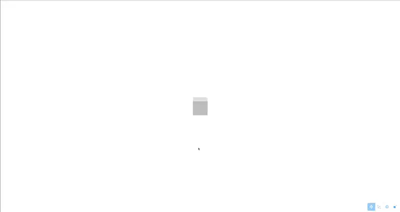

<!--
This README describes the package. If you publish this package to pub.dev,
this README's contents appear on the landing page for your package.

For information about how to write a good package README, see the guide for
[writing package pages](https://dart.dev/tools/pub/writing-package-pages).

For general information about developing packages, see the Dart guide for
[creating packages](https://dart.dev/guides/libraries/create-packages)
and the Flutter guide for
[developing packages and plugins](https://flutter.dev/to/develop-packages).
-->

# flutter_scene_manipulation 

An extension for [flutter_scene](https://pub.dev/packages/flutter_scene) that adds tools for translating, rotating and scaling induvidual nodes using manipulation gizmos.



## Getting Started

### Requirements 

- [flutter_scene](https://pub.dev/packages/flutter_scene) ^0.24.3
- [vector_math](https://pub.dev/packages/vector_math) ^2.4.3

### Installation

```sh
flutter pub add flutter_scene_manipulation
```

## Usage

> [!WARNING]
> This code relies on specific strings within node names to manipulate objects. Avoid the use of `_gizmo` or `_mesh` anywhere in a node name, and `_x`, `_y` or `_z` at the end of a node name.  

### Types of Manipulation

- **Free Drag:** The user can click on the node mesh and drag it around the screen, the node will move in the 3D plane of the camera.
- **Translation:** A translation gizmo will appear when the user clicks on the node mesh, consisting of three arrows with pointed tips, one for each axis. The user can then use the gizmo handles to move the object in 3D space.
- **Rotation:** A rotation gizmo will appear when the user clicks on the node mesh, consisting of 3 rings, one for each axis. The user can then use the gizmo handles to rotate the object in 3D space.
- **Scaling:** A scaling gizmo will appear hen the user clicks on the node mesh, consisting of three arrows with box tips, one for each axis. The user can then use the gizmo handles to scale the object in 3D space.

### Classes

- **`ManipulatableNode`:** an extension of `Node` from `flutter_scene` that allows manipulation. There is an extra argument `options` which is `Set` of `ManipulationOptions`, which correspond to the types of manipulation. This set determines what manipulaations are allowed for that node.
- **`ManipulatableView:`:** a widget similar to `SceneView` from `flutter_scene` that controls the manipulation of objects in its `scene`. This *must* be used for `ManipulatableNode` to work.
- **`ManipulationControls`:** a convenience widget containing a `ToggleButtons` that selects which manipulation to perform. Users can also use the icons in `ManipulationIcons` to create their own buttons.

### Minimal Example

This will generate a cube that can be freely dragged across the screen.

```dart
import 'package:flutter/material.dart';
import 'package:flutter_scene/scene.dart';
import 'package:flutter_scene_manipulation/flutter_scene_manipulation.dart';
import 'package:vector_math/vector_math.dart' as vm;

class CubeView extends StatefulWidget {
    const CubeView({super.key});

    @override
    State<CubeView> createState() => _CubeViewState();
}

class _CubeViewState extends State<CubeView> { 
    final Scene scene = Scene();

    final Node camera = Node()..addComponent(CameraComponent(activateOnMount: true));

    ManipulationOptions currentOption_ = ManipulationOptions.freedrag;

    @override
    void initState() {
        super.initState();

        scene.add(
        ManipulatableNode(
            options: {
            ManipulationOptions.freedrag
            },
            mesh: Mesh(
            CuboidGeometry(vm.Vector3(0.1, 0.1, 0.1)),
            PhysicallyBasedMaterial(),
            ),
        ),
        );
        scene.add(camera);
    }

    @override
    Widget build(BuildContext context) {
        final cameraController = camera.getComponent<OrbitCameraController>()!;
        return LayoutBuilder(
            builder: (context, constraints) {
                return ManipulatableView(
                    camera: camera.getComponent<CameraComponent>()!.toCamera(),
                    constraints: constraints,
                    currentOption: currentOption_,
                    child: SceneView(scene),
                );
            }
        );
    }

}
```

for a more complete example see the [example](https://github.com/ralphieraccoon/flutter_scene_manipulation/tree/master/example/lib/main.dart) file.

